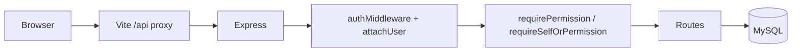

# ASK HRFlow Architecture

## Stack

- **Frontend:** Vite 6 + React 18 + TypeScript + Tailwind/shadcn (Figma Make UI preserved)
- **Backend:** Express 4 + TypeScript (`tsx` runtime) under `server/src/`
- **Database:** MySQL 8 (`mysql2` driver), multi-tenant column `tenant_id` (default `t-default`)
- **Auth:** JWT in httpOnly cookie `hrflow_token`, bcrypt passwords
- **API docs:** Swagger UI at `/api/docs`

## Request flow

## RBAC

- **Role templates** in `role_permissions` (seeded from frontend defaults; HR gets `access` read/create/update)
- **User overrides** in `user_permissions` (JSON action arrays per module)
- **Admin** always has full module access (computed, not stored)
- Middleware: `requirePermission(module, action)`, `requireSelfOrPermission` for employee-linked records

## Modules

| Area | Routes | Notes |
|------|--------|--------|
| Auth | `/api/auth/*` | login, logout, me |
| Employees | `/api/employees` | pagination, search; salary hidden without `employees:update` |
| Attendance | `/api/attendance/*` | check-in/out events → `attendance_days` aggregates |
| Leave | `/api/leave/*` | balances, overlap + balance validation, approve transactions |
| Timesheets | `/api/timesheets/*` | draft → submit → approve/reject/lock |
| Dashboard | `/api/dashboard/stats` | SQL aggregates only |
| Access | `/api/access/*` | users + permissions |
| Notices | `/api/notices` | mark read |
| Audit | `/api/audit` | admin |
| Stubs | payroll, recruitment, performance, documents, settings, reports, shifts | minimal CRUD |

## Configuration

- `DATABASE_URL` **or** `DB_HOST`, `DB_PORT`, `DB_NAME`, `DB_USER`, `DB_PASSWORD`
- `JWT_SECRET`, `PORT`, `CORS_ORIGIN`

## Scripts

- `npm run dev` — API + Vite
- `npm run db:seed` — apply `server/schema.sql` + demo data
- `npm start` — production API (serves `dist/`)

## Demo users

| Email | Role | Password |
|-------|------|----------|
| alvi@automystics.com | admin | demo123 |
| priya.nair@automystics.com | hr | demo123 |
| rahul.verma@automystics.com | employee | demo123 |
